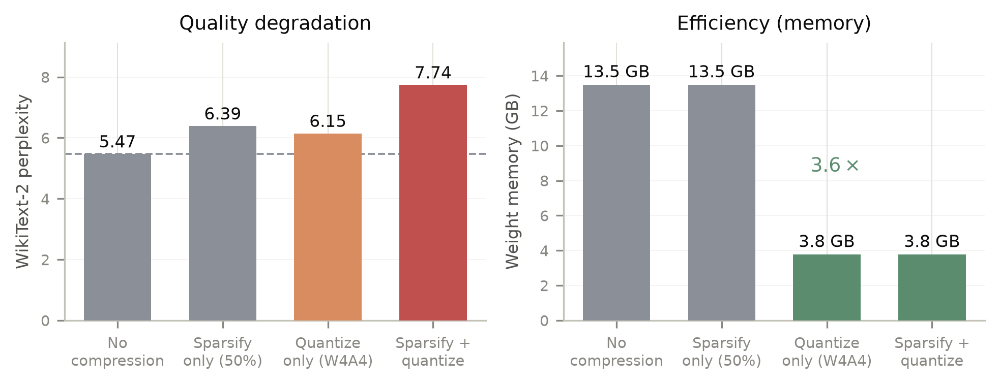
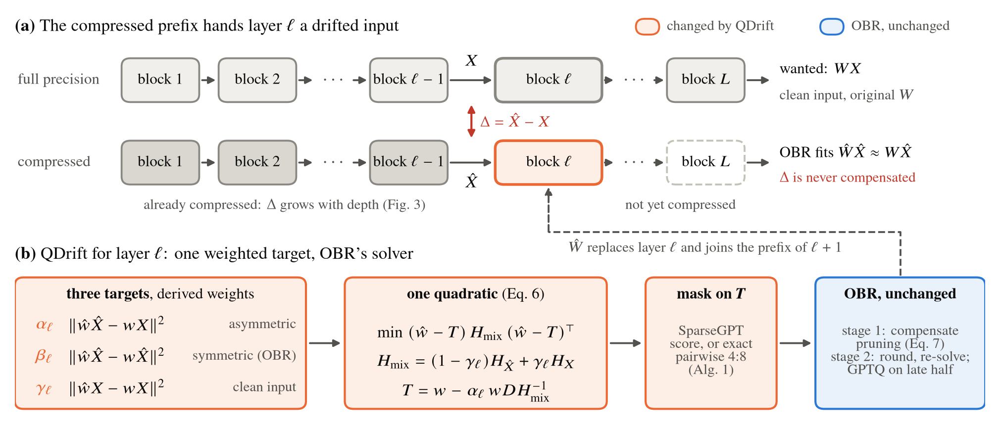
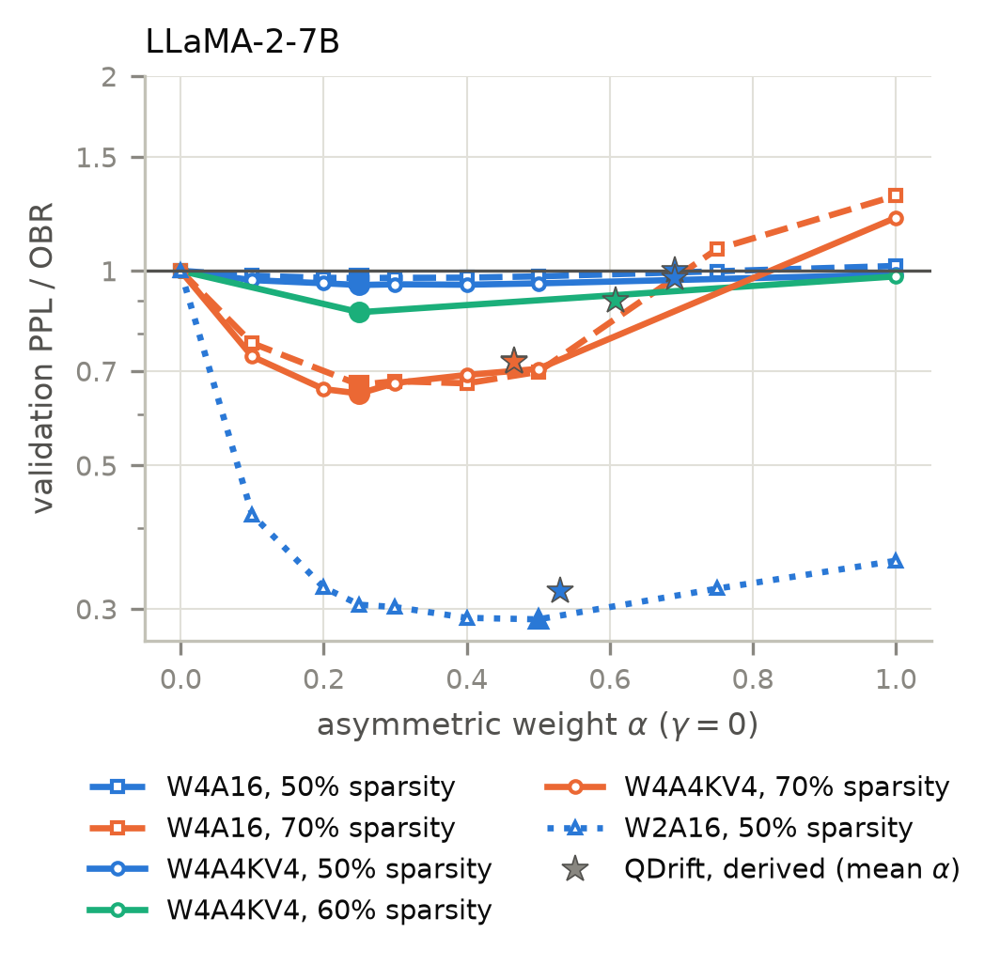
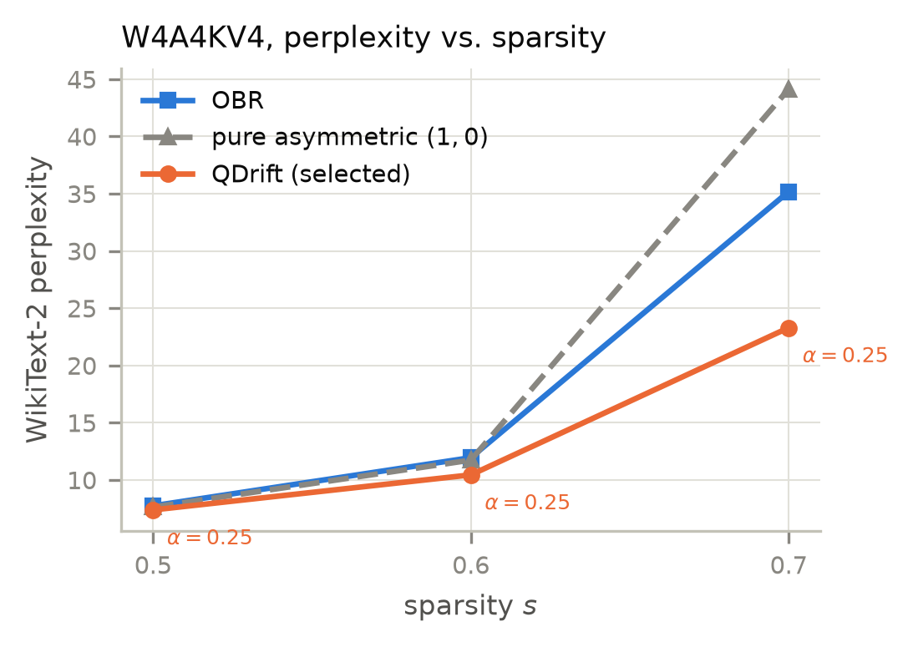
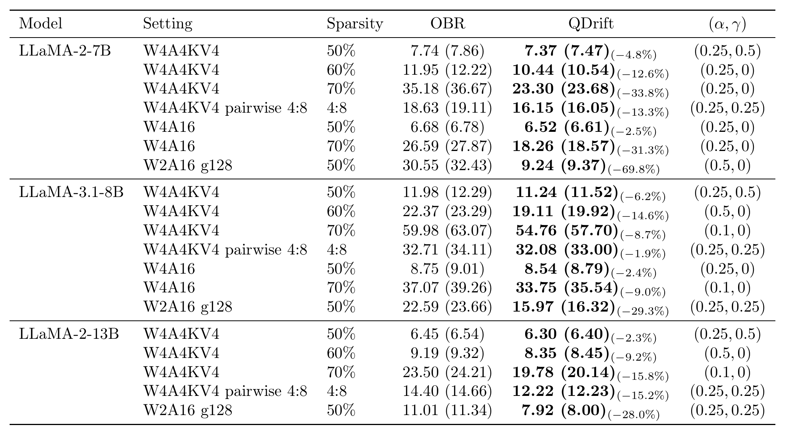

<div align="center">

# QDrift-JSQ-OBR

**A constrained mixture of reconstruction targets for joint sparsification and low-bit quantization of LLMs**

[](LICENSE)
[](https://www.python.org/)
[](https://pytorch.org/)
[](https://github.com/NVIDIA/cutlass)
[](#qdrift)

</div>

QDrift compresses decoder-only LLMs by pruning, quantization and closed-form error compensation,
all at once and without retraining. It builds on OBR's two-stage compensation and changes the
objective that compensation minimizes.

<p align="center">
  
  <br/>
  <sub><em>Pruning or 4-bit quantization alone costs little perplexity on LLaMA-2-7B, but combining
  them compounds the error, and the memory saving comes from the quantization. QDrift targets this
  joint regime.</em></sub>
</p>

OBR fits each layer to the input *drifted* by the already compressed prefix, so the drift it
inherits is never corrected. Correcting that drift fully (the asymmetric, GPTAQ-style target)
overfits the small calibration set. QDrift instead minimizes a constrained mixture of three
targets:

$$
\min_{\hat W}\ \alpha\,\underbrace{\mathbb E\|\hat W\hat X - WX\|^2}_{\text{asymmetric}}
\;+\;\beta\,\underbrace{\mathbb E\|\hat W\hat X - W\hat X\|^2}_{\text{OBR (symmetric)}}
\;+\;\gamma\,\underbrace{\mathbb E\|\hat W X - WX\|^2}_{\text{clean input}},
\qquad \beta = 1-\alpha-\gamma .
$$

The mixture collapses to one Hessian and one per-row target, so OBR's solver, both of its stages,
GPTQ and the mask score all run unchanged. Setting $(\alpha,\gamma)=(0,0)$ gives OBR exactly.

<p align="center">
  
  <br/>
  <sub><em>How QDrift compresses one linear layer. Orange marks what QDrift changes; blue marks OBR's
  steps, which run unchanged.</em></sub>
</p>

One global $(\alpha,\gamma)$ is chosen per setting on WikiText-2 *validation* perplexity, from a
grid that contains OBR. On that criterion QDrift is therefore never worse than OBR.

A second, independent contribution is an **exact block-sequential selection of pairwise 4:8
masks**, the only sparse layout that INT4 sparse tensor cores execute. It costs the same as GPTQ.

## Highlights

WikiText-2 test perplexity (lower is better). Calibration is 128 × 1024 tokens from WikiText-2,
with a SparseGPT mask and GPTQ on the late half:

| Model | Setting | OBR | QDrift | $(\alpha,\gamma)$ |
|---|---|---:|---:|:---:|
| LLaMA-2-7B | W4A4KV4, 70% unstructured | 35.18 | **23.30** (−33.8%) | (0.25, 0) |
| LLaMA-2-7B | W2A16 g128, 50% unstructured | 30.55 | **9.24** (−69.8%) | (0.5, 0) |
| LLaMA-2-7B | W4A4KV4, pairwise 4:8 (exact mask) | 18.63 | **16.15** (−13.3%) | (0.25, 0.25) |
| LLaMA-3.1-8B | W2A16 g128, 50% unstructured | 22.59 | **15.97** (−29.3%) | (0.25, 0.25) |
| LLaMA-2-13B | W2A16 g128, 50% unstructured | 11.01 | **7.92** (−28.0%) | (0.25, 0.25) |

- **Mask.** On LLaMA-2-7B the exact pairwise mask alone lowers OBR's perplexity from 21.42 to
  18.63.
- **Kernels.** On an RTX 4090, the pairwise 4:8 sparse INT4 GEMM is 1.14–1.34× faster than dense
  INT4 at prefill and 1.87–3.05× faster at decode.
- **Zero-shot.** The gains carry over clearly at two-bit weights. Elsewhere they are roughly
  accuracy-neutral.

<p align="center">
  
  
  <br/>
  <sub><em>Left: in every swept setting a small asymmetric weight beats OBR (α = 0), and
  the range of α that does so shrinks as sparsity rises; the pure target (α = 1) is often worse. Right: across sparsity
  levels, the selected mixture stays below OBR, while the pure target crosses above it.</em></sub>
</p>

<details>
<summary><b>Full main table</b> (all 19 settings, three models)</summary>
<br/>
<p align="center">
  
</p>
</details>

The full tables are in [`tables/`](tables), and every number comes from
[`visualize/`](#reproducing-the-paper).

## Installation

```bash
git clone <this repository> && cd QDrift-JSQ-OBR
pip install -r requirements.txt        # torch>=2.6, transformers>=5, lm-eval, ...
```

**Models.** Models are listed in [`modelzoo/manifest.yaml`](modelzoo/manifest.yaml): LLaMA-2
7B/13B/70B and LLaMA-3/3.1 8B/70B. Weights are read from each entry's `local_path`.

**Kernels.** The INT4 kernels are optional and only needed for the benchmarks. They compile on
first use with `torch.utils.cpp_extension`.
- The W4A4 dense and sparse kernels need the CUTLASS headers. Point `CUTLASS_INCLUDE` at a CUTLASS
  `include/` directory.
- W4A16 uses the bundled Marlin and Sparse-Marlin kernels.

## Quick start

Reproduce the headline row, OBR and QDrift on LLaMA-2-7B at W4A4KV4 with 70% sparsity:

```bash
scripts/reproduce.sh                   # extra flags pass through, e.g. --devices cuda:1 --zeroshot
```

Each run compresses one model, evaluates it and writes `results/v2/<run name>.json`. The JSON holds
the WikiText-2 test and validation perplexity, plus zero-shot accuracy if `--zeroshot` is given.
The general form is:

```bash
python -m main run --model llama2-7b \
  --criterion sparsegpt --structure unstructured --sparsity 0.7 \
  --w-bits 4 --a-bits 4 --kv-bits 4 --w-gran channel --grid midtread --range clip --quant gptq \
  --nsamples 128 --seqlen 1024 --seed 42 \
  --comp drift
```

## Command line

`python -m main` has three subcommands. The `scripts/` wrappers call them.

| Subcommand | What it does |
|---|---|
| `run` | Compress one joint checkpoint under its run name and evaluate PPL (and zero-shot). Used for every paper result. |
| `compress` | Write the four comparison checkpoints: dense, sparse, quant and joint (`scripts/compress.sh`). |
| `benchmark` | Accuracy and efficiency of those four checkpoints (`scripts/benchmark.sh`). |

The flags that matter most:

| Flag | Meaning |
|---|---|
| `--comp {none,obr,drift}` | Compensation objective. `drift` is the QDrift mixture. |
| `--mix-rule {auto,fixed}` | `auto` (default for `drift`) derives every layer group's (α, γ) from its own calibration statistics (`docs/mix-auto.md`); `fixed` uses one global pair (grid search and ablations). |
| `--mix-asym α`, `--mix-clean γ` | Fixed mixture weights (`--mix-rule fixed`). `(0, 0)` is OBR and `(1, 0)` the pure asymmetric target. |
| `--mix-blocks A-B`, `--mix-modules {attn,mlp_in,mlp_out}` | With `--mix-rule fixed`: apply the mixture only to some layers, with OBR elsewhere (localization ablation). |
| `--structure {unstructured,2:4,4:8}`, `--sparsity` | Sparsity pattern and level. |
| `--pairwise-fraction f` | Share of 2:4 / 4:8 layers using the hardware pairwise layout. `1.0` = every layer, the only INT4-deployable choice. |
| `--mask-select {score,obs}` | N:M mask from the criterion score, or the exact block-sequential selection. |
| `--criterion {magnitude,wanda,sparsegpt}` | Pruning score. |
| `--w-bits`, `--a-bits`, `--kv-bits`, `--w-gran`, `--w-group-size`, `--grid` | Quantizer bit widths, granularity and grid (`midtread` / `midrise`). |
| `--quant {rtn,gptq}`, `--range {full,clip}` | Weight quantizer and range search. |
| `--nsamples`, `--seqlen`, `--seed` | WikiText-2 calibration set. |
| `--offload` | Compress block by block from host memory, e.g. LLaMA-2-13B on a 24 GB GPU. Bit-identical. |
| `--zeroshot`, `--eval-shard` | lm-eval zero-shot tasks, and sharding the evaluation model across GPUs. |

Run `python -m main <subcommand> --help` for the rest.

### Sparse layouts

| `--structure` | Mask | W4A4 kernel |
|---|---|---|
| `unstructured` | Global top-k per output row | Dense INT4 |
| `2:4`, `4:8` | Element-wise N:M in a `1 − f` share of layers, pairwise N:M in the least sensitive `f` share | Dense INT4, plus CUTLASS INT4 sparse for the pairwise layers |

INT4 sparse tensor cores execute only **pairwise 4:8**: in every 8 input channels, keep 2 of the
4 aligned channel pairs. Use `--structure 4:8 --pairwise-fraction 1.0` for a fully deployable
INT4 sparse model.

## Reproducing the paper

Everything the paper shows is generated from the result records. No number, table or figure is
written by hand.

```bash
python visualize/tables/paper_tables.py    # tables/tex/*.tex · tables/pdf/*.pdf · tables/png/*.png
python visualize/tables/paper_numbers.py   # tables/tex/numbers.tex: \qd{<key>} for every number in the text
python visualize/plots/paper_figures.py    # figs/png/*.png · figs/pdf/*.pdf
```

- **Protocol.** WikiText-2 only: calibrate on train, select $(\alpha,\gamma)$ on validation, report
  test at sequence length 2048.
- **Determinism.** `figs/` and `tables/` are committed, and an unchanged rebuild reproduces them
  byte for byte.
- **Text numbers.** `numbers.tex` uses the same selection code as the tables, so the text and the
  tables cannot disagree. An unknown key is a LaTeX compile error.

## Checkpoints and benchmarks

`compress` writes four checkpoints per recipe, each named by its full recipe:

| Regime | Weights | Meaning |
|---|---|---|
| `dense` | fp16 | No pruning, no quantization |
| `sparse` | fp16 + mask | Pruning only |
| `quant` | intN | Quantization only |
| `joint` | intN + mask | Pruning + quantization |

`benchmark` loads each checkpoint once. It merges everything into
`results/benchmarks/<checkpoint>__<tasks>.json`:
- accuracy: WikiText-2 perplexity and zero-shot;
- efficiency: real-kernel prefill and decode latency, throughput and peak memory.

```bash
scripts/compress.sh --model llama2-7b --structure 4:8 --pairwise-fraction 1.0 --single
scripts/benchmark.sh --model llama2-7b --structure 4:8 --pairwise-fraction 1.0 --tasks all
```

`--engine inference` measures the graph-friendly runtime instead. It runs cuBLAS for dense, CUTLASS
sparse for sparse fp16, and Marlin / Sparse-Marlin for INT4 W4A16, and it requires
`--rotation none`. If structured sparse acceleration is unavailable, the sparse e2e measurements
are skipped and accuracy falls back to dense kernels (`--no-sparse-accel` forces this).

## Repository layout

```text
main.py                    single entry point: run / compress / benchmark
qdrift/
  compress/                recipes, run names, the layer-wise compression pipeline
  obr/                     OBR compensation, calibration streams, the QDrift mixture (drift.py)
  prune/                   pruning criteria, N:M and pairwise masks, exact mask selection
  quant/                   quantizers, scale search, GPTQ, packing
  quarot/, models/         Hadamard rotation and model loading
benchmark/                 evaluation, inference runtime, INT4 / Marlin / CUTLASS kernels
minitests/                 focused diagnostics (e.g. drift accumulation)
visualize/                 paper tables, text numbers and figures
tables/, figs/             generated paper artefacts (committed)
tests/                     unit tests (mixture, OBR identity, mask selection, activation quantizer)
scripts/                   shell wrappers and reproduce.sh
```

## Tests

```bash
pytest tests/
```

The tests need PyTorch. `test_obr_identity.py` checks that $(0,0)$ reproduces OBR
exactly. `test_mixture.py` checks the mixture algebra and the localized mixture.

## Acknowledgements

Parts of this code are adapted from the following projects, under their Apache-2.0 licenses. The
source and commit are noted at the top of each adapted file.
- [OBR](https://github.com/csguoh/OBR): compensation.
- [QuaRot](https://github.com/spcl/QuaRot): rotation, Hadamard transforms, packing and the dense
  INT4 CUTLASS GEMM.
- [Sparse-Marlin](https://github.com/IST-DASLab/Sparse-Marlin): the Marlin and Sparse-Marlin
  kernels in `benchmark/kernels/marlin`, with their own
  [LICENSE](benchmark/kernels/marlin/LICENSE).

## License

QDrift is released under the [Apache License 2.0](LICENSE).
